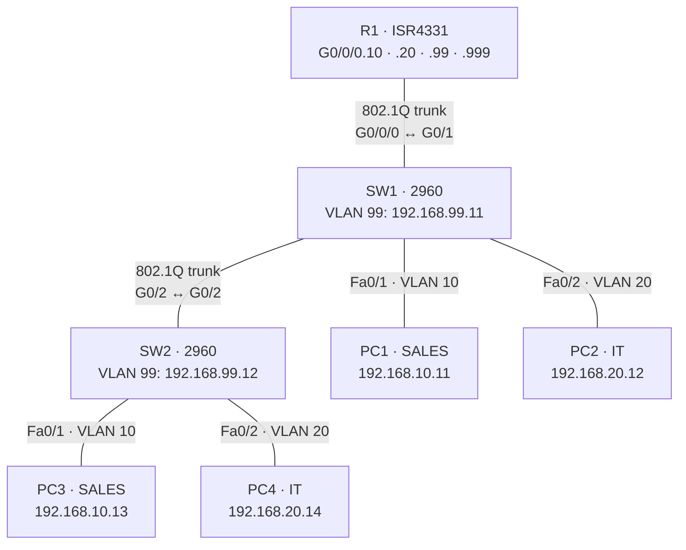

# 001 — VLANs, 802.1Q Trunking & Router-on-a-Stick

| Date | Track | Exam Topics | Difficulty | Est. Time |
|------|-------|-------------|------------|-----------|
| 2026-11-16 | CCNA 200-301 | 2.1 VLANs · 2.2 Trunking (802.1Q, native VLAN) · 4.8 SSH | ⭐⭐☆☆☆ | 60–90 min |

## 🎯 Objective

Split one flat LAN into separate broadcast domains (Sales, IT, Management), carry them
across two switches on 802.1Q trunks, and route between them with a single router
interface (router-on-a-stick). Every device is hardened with a secure management baseline.

- [ ] Create VLANs 10, 20, 99, 998, 999 and assign access ports
- [ ] Build static 802.1Q trunks with DTP disabled, native VLAN 999 and a pruned allowed list
- [ ] Configure R1 subinterfaces as the default gateway for each VLAN
- [ ] Reach every PC from every other PC (inter-VLAN routing)
- [ ] SSH into SW1/SW2 management IPs from a PC; Telnet must be refused

## 🗺️ Topology



### VLAN Plan

| VLAN | Name | Purpose | Subnet | Gateway (R1) |
|------|------|---------|--------|--------------|
| 10 | SALES | Users | 192.168.10.0/24 | 192.168.10.1 |
| 20 | IT | Users | 192.168.20.0/24 | 192.168.20.1 |
| 99 | MGMT | Switch SVIs | 192.168.99.0/24 | 192.168.99.1 |
| 998 | PARKING | Unused ports (shut down) | — | — |
| 999 | NATIVE | Trunk native VLAN, no users | — | — |

### Addressing Table

| Device | Interface | IP Address | Mask | Gateway |
|--------|-----------|------------|------|---------|
| R1 | G0/0/0.10 | 192.168.10.1 | 255.255.255.0 | — |
| R1 | G0/0/0.20 | 192.168.20.1 | 255.255.255.0 | — |
| R1 | G0/0/0.99 | 192.168.99.1 | 255.255.255.0 | — |
| SW1 | VLAN 99 | 192.168.99.11 | 255.255.255.0 | 192.168.99.1 |
| SW2 | VLAN 99 | 192.168.99.12 | 255.255.255.0 | 192.168.99.1 |
| PC1 | Fa0 | 192.168.10.11 | 255.255.255.0 | 192.168.10.1 |
| PC2 | Fa0 | 192.168.20.12 | 255.255.255.0 | 192.168.20.1 |
| PC3 | Fa0 | 192.168.10.13 | 255.255.255.0 | 192.168.10.1 |
| PC4 | Fa0 | 192.168.20.14 | 255.255.255.0 | 192.168.20.1 |

> The last octet of each PC matches its PC number, which makes ping tests easy to read.

## 🧰 Tools & Platform

- **Cisco Packet Tracer 8.x**
- R1: **ISR4331** · SW1/SW2: **2960-24TT** · PC1–PC4: **PC-PT**

## 📁 Files

| File | Description |
|------|-------------|
| [`LAB-GUIDE.md`](LAB-GUIDE.md) | **Start here.** Click-by-click Packet Tracer build with checkpoints after every step |
| [`configs/R1.cfg`](configs/R1.cfg) | Router-on-a-stick subinterfaces, SSH, hardening |
| [`configs/SW1.cfg`](configs/SW1.cfg) | VLANs, two trunks, access ports, MGMT SVI |
| [`configs/SW2.cfg`](configs/SW2.cfg) | VLANs, trunk to SW1, access ports, MGMT SVI |
| [`troubleshooting.md`](troubleshooting.md) | 3 break/fix tickets with hidden solutions |
| `topology/` | Save your Packet Tracer file here (e.g. `001-vlan-roas.pkt`) |

## 🚀 How to Build

1. **Place devices:** one ISR4331, two 2960-24TT, four PC-PT.
2. **Cable** with Copper Straight-Through:

   | From | To |
   |------|----|
   | R1 G0/0/0 | SW1 G0/1 |
   | SW1 G0/2 | SW2 G0/2 |
   | PC1 Fa0 → SW1 Fa0/1 | PC2 Fa0 → SW1 Fa0/2 |
   | PC3 Fa0 → SW2 Fa0/1 | PC4 Fa0 → SW2 Fa0/2 |

3. **Configure the PCs** (Desktop → IP Configuration) from the addressing table.
4. **Configure the devices.** Open each `.cfg`, replace `<REDACTED>` with a lab
   password, and paste it into the device CLI. Order: **SW2 → SW1 → R1**.
   > While one end of a trunk has native VLAN 999 and the other still has VLAN 1,
   > you'll see `%CDP-4-NATIVE_VLAN_MISMATCH` messages. They stop once both ends match.
5. Click **Fast Forward Time** a few times so the switch ports reach forwarding state, then verify.

## ✅ Verification

| # | Where | Command | Expected Result |
|---|-------|---------|-----------------|
| 1 | SW1/SW2 | `show vlan brief` | Fa0/1 in VLAN 10, Fa0/2 in VLAN 20, spare ports in 998 |
| 2 | SW1/SW2 | `show interfaces trunk` | Trunks `on`, `802.1q`, native **999**, allowed `10,20,99,999` |
| 3 | SW1 | `show interfaces g0/1 switchport` | `Negotiation of Trunking: Off` |
| 4 | R1 | `show ip interface brief` | G0/0/0 and .10/.20/.99 `up/up` |
| 5 | PC1 | `ping 192.168.10.13` | Same VLAN, works without R1 |
| 6 | PC1 | `ping 192.168.20.14` | Inter-VLAN, routed by R1 |
| 7 | PC1 | `tracert 192.168.20.14` | Hop 1 = `192.168.10.1`, hop 2 = `192.168.20.14` |
| 8 | PC1 | `ssh -l admin 192.168.99.11` | Password prompt, then `SW1#` |
| 9 | PC1 | `telnet 192.168.99.11` | Connection refused |

<details>
<summary><b>Sample output — <code>show interfaces trunk</code> on SW1</b></summary>

```
Port        Mode         Encapsulation  Status        Native vlan
Gig0/1      on           802.1q         trunking      999
Gig0/2      on           802.1q         trunking      999

Port        Vlans allowed on trunk
Gig0/1      10,20,99,999
Gig0/2      10,20,99,999

Port        Vlans allowed and active in management domain
Gig0/1      10,20,99,999
Gig0/2      10,20,99,999

Port        Vlans in spanning tree forwarding state and not pruned
Gig0/1      10,20,99,999
Gig0/2      10,20,99,999
```
</details>

<details>
<summary><b>Sample output — <code>show ip interface brief</code> on R1</b></summary>

```
Interface                IP-Address      OK? Method Status                Protocol
GigabitEthernet0/0/0     unassigned      YES unset  up                    up
GigabitEthernet0/0/0.10  192.168.10.1    YES manual up                    up
GigabitEthernet0/0/0.20  192.168.20.1    YES manual up                    up
GigabitEthernet0/0/0.99  192.168.99.1    YES manual up                    up
GigabitEthernet0/0/0.999 unassigned      YES unset  up                    up
GigabitEthernet0/0/1     unassigned      YES unset  administratively down down
GigabitEthernet0/0/2     unassigned      YES unset  administratively down down
```
</details>

> The first ping to a new destination may lose one reply while ARP resolves. That's normal.

## 🧠 Key Concepts

- **VLAN = broadcast domain = subnet.** Hosts in different VLANs need a Layer 3 device to talk.
- **802.1Q** inserts a 4-byte tag (12-bit VLAN ID → 4094 usable VLANs). Frames in the
  **native VLAN** cross the trunk untagged, so the native VLAN must match on both ends.
- **Why move the native VLAN off VLAN 1?** It blocks double-tagging VLAN-hopping attacks and
  keeps user traffic out of the default VLAN that every port starts in.
- **`switchport nonegotiate`** turns off DTP, so nobody can plug in a device and negotiate a trunk.
- **Router-on-a-stick** trades bandwidth for cost: all inter-VLAN traffic shares one link.
  At scale, a Layer 3 switch with SVIs replaces it.
- **`ip default-gateway`** is needed on a Layer 2 switch (no `ip routing`) so its management
  IP can reply to hosts in other subnets.

## 📝 My Notes

<!-- Write what you ran into while building this: errors, surprises, what clicked. -->
-

## 🔗 References

- Cisco — [Configuring VLANs on Catalyst 2960](https://www.cisco.com/c/en/us/td/docs/switches/lan/catalyst2960/software/release/15-0_2_se/configuration/guide/scg2960/swvlan.html)
- Cisco — [Inter-VLAN Routing with Router-on-a-Stick](https://www.cisco.com/c/en/us/support/docs/lan-switching/inter-vlan-routing/41860-howto-L3-intervlanrouting.html)
- IEEE 802.1Q — VLAN tagging standard
